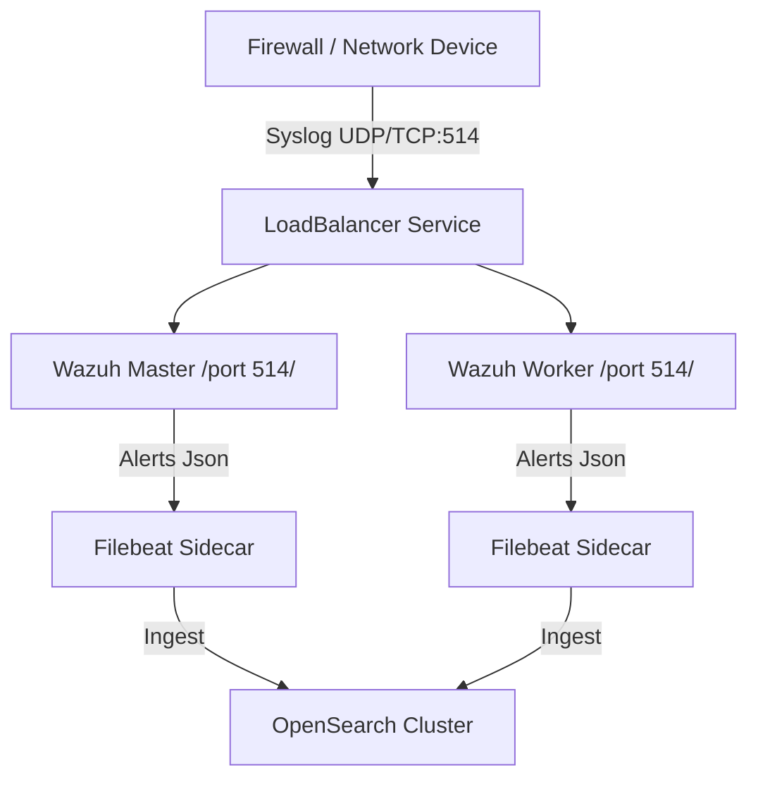

# M1.5 — Syslog Receiver — Firewall Log Ingestion

This guide describes how to configure the Wazuh manager cluster as a centralized syslog receiver to ingest firewall and network logs (e.g. Fortinet, pfSense) over UDP and TCP port 514, decode the event payloads, and map alerts to the OpenSearch SIEM dashboard.

---

## 1. Architectural Overview

The Wazuh manager cluster can act as a syslog collector on ports UDP/TCP 514 without requiring a separate logstash or syslog-ng pipeline. Network devices forward logs directly to the Wazuh service endpoints, feeding the same rules engine as standard agent data.



---

## 2. Wazuh Manager Configuration (`ossec.conf`)

To enable the remote syslog listener, add the following `<remote>` blocks to your manager's `/var/ossec/etc/ossec.conf` file:

```xml
<ossec_config>
  <!-- Syslog listener for UDP traffic -->
  <remote>
    <connection>syslog</connection>
    <port>514</port>
    <protocol>udp</protocol>
    <allowed-ips>0.0.0.0/0</allowed-ips>
  </remote>

  <!-- Syslog listener for TCP traffic -->
  <remote>
    <connection>syslog</connection>
    <port>514</port>
    <protocol>tcp</protocol>
    <allowed-ips>0.0.0.0/0</allowed-ips>
  </remote>
</ossec_config>
```

---

## 3. Kubernetes Port Expositions

The Wazuh StatefulSet / Deployment and service must expose port 514:

### Service Port Mapping
```yaml
apiVersion: v1
kind: Service
metadata:
  name: wazuh
  namespace: aml-lab
spec:
  type: LoadBalancer
  selector:
    app: wazuh-manager
  ports:
    - name: agent-conn-tcp
      port: 1514
      targetPort: 1514
      protocol: TCP
    - name: syslog-udp
      port: 514
      targetPort: 514
      protocol: UDP
    - name: syslog-tcp
      port: 514
      targetPort: 514
      protocol: TCP
```

---

## 4. Firewall Rule Configuration

### Host Firewall (UFW)
Open port 514 UDP/TCP on the host nodes:
```bash
sudo ufw allow 514/udp comment 'Wazuh Syslog UDP'
sudo ufw allow 514/tcp comment 'Wazuh Syslog TCP'
sudo ufw status
```

### Cloud Firewall (GCP VPC)
Ensure the GCP firewall rule allows port 514 traffic:
```bash
gcloud compute firewall-rules update allow-wazuh --allow tcp:1514,tcp:1515,tcp:55000,tcp:514,udp:514
```

---

## 5. Vendor Configuration Setups

### Fortinet FortiGate Setup
1. Log in to the FortiGate GUI.
2. Navigate to **Log & Report** > **Log Settings**.
3. Toggle **Send Logs to Syslog** to enabled.
4. Input the Wazuh LoadBalancer Public IP as the **IP Address/FQDN**.
5. Select **UDP** (or TCP) and enter Port **514**.
6. Set log categories to forward **Event Logging** and **Security Events**.
7. Click **Apply**.

Alternatively, configure via FortiGate CLI:
```text
config log syslogd setting
    set status enable
    set server "34.18.214.72"
    set mode udp
    set port 514
    set facility local7
end
```

### pfSense Setup
1. Log in to the pfSense WebGUI.
2. Navigate to **Status** > **System Logs** > **Settings**.
3. Scroll down to **Remote Logging Options**.
4. Check **Send system logs to remote syslog server**.
5. Set **IP Protocol** to IPv4.
6. Under **Remote Syslog Servers**, input the Wazuh LoadBalancer public IP followed by port: `34.18.214.72:514`.
7. Check the types of logs to send (e.g. **Firewall Events**, **System Events**).
8. Click **Save**.

---

## 6. Verification and Testing

### 6.1 Manual Log Simulation (Test Payload)
To simulate a FortiGate log event and test decoding, send a raw syslog packet to the Wazuh Manager's external IP:

#### UDP Syslog simulation:
```bash
echo '<189>date=2026-07-18 time=04:30:00 devname="FG100E" devid="FGT100E000000000" logid="0100032001" type="event" subtype="system" level="warning" actn="interface-stat-change" fstatus="down" msg="Link monitor: Interface port1 turned down"' | nc -u -w1 34.18.214.72 514
```

### 6.2 Confirming Decoders and Rules
To verify that Wazuh matches this log correctly:
1. Log in to the **Wazuh Dashboard**.
2. Navigate to **Discover** or **Security Events**.
3. Search for:
   * `decoder.name: "fortigate"`
   * `rule.id: "44612"`
4. Verify that the metadata fields (such as `devid`, `devname`, `fstatus`, `actn`) are correctly extracted and populated in the JSON document.
