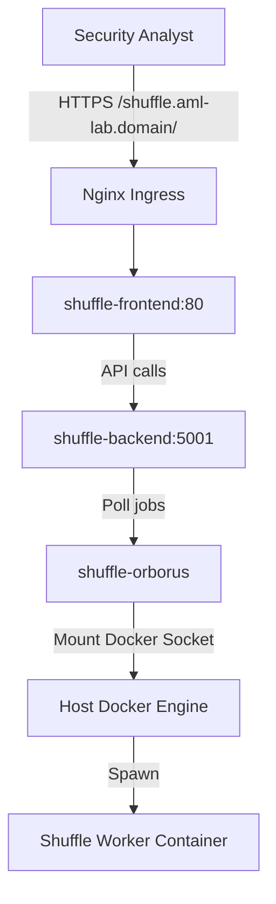

# M2.1 — Shuffle SOAR 2.0+ — Deployment

This guide describes how to deploy Shuffle SOAR (latest) on the Kubernetes cluster in namespace `aml-lab`, configure it to use persistent volume storage, expose it securely via Nginx Ingress with Let's Encrypt TLS, and install/connect the Wazuh active response app.

---

## 1. Architectural Overview

Shuffle consists of a frontend (UI), backend (orchestrator & api), and orborus (runner orchestrator). In a single-node VM Kubernetes configuration, Orborus mounts the host's Docker socket `/var/run/docker.sock` to execute custom app workers inside standard Docker containers, bridging Kubernetes management with local host execution.



---

## 2. Kubernetes Resource Manifests

### 2.1 Persistent Volume Claim (`shuffle-backend-pvc`)
Create a persistent volume claim to retain workflow configurations, databases, and variables:
```yaml
apiVersion: v1
kind: PersistentVolumeClaim
metadata:
  name: shuffle-backend-pvc
  namespace: aml-lab
spec:
  accessModes:
    - ReadWriteOnce
  resources:
    requests:
      storage: 10Gi
```

### 2.1b Dedicated OpenSearch Deployment & Service
Shuffle requires its own OpenSearch database to store workflows and indexes properly.
```yaml
apiVersion: apps/v1
kind: Deployment
metadata:
  name: shuffle-opensearch
  namespace: aml-lab
spec:
  replicas: 1
  selector:
    matchLabels:
      app: shuffle-opensearch
  template:
    metadata:
      labels:
        app: shuffle-opensearch
    spec:
      containers:
      - name: opensearch
        image: opensearchproject/opensearch:2.11.0
        env:
        - name: discovery.type
          value: "single-node"
        - name: OPENSEARCH_JAVA_OPTS
          value: "-Xms512m -Xmx512m"
        - name: DISABLE_SECURITY_PLUGIN
          value: "true"
        ports:
        - containerPort: 9200
        volumeMounts:
        - name: opensearch-data
          mountPath: /usr/share/opensearch/data
      volumes:
      - name: opensearch-data
        persistentVolumeClaim:
          claimName: shuffle-opensearch-pvc
---
apiVersion: v1
kind: PersistentVolumeClaim
metadata:
  name: shuffle-opensearch-pvc
  namespace: aml-lab
spec:
  accessModes:
    - ReadWriteOnce
  resources:
    requests:
      storage: 10Gi
---
apiVersion: v1
kind: Service
metadata:
  name: shuffle-opensearch
  namespace: aml-lab
spec:
  selector:
    app: shuffle-opensearch
  ports:
  - port: 9200
    targetPort: 9200
```

### 2.2 Shuffle Backend Deployment & Service
The backend manages data structure and API orchestration:
```yaml
apiVersion: apps/v1
kind: Deployment
metadata:
  name: shuffle-backend
  namespace: aml-lab
spec:
  replicas: 1
  selector:
    matchLabels:
      app: shuffle-backend
  template:
    metadata:
      labels:
        app: shuffle-backend
    spec:
      containers:
      - name: shuffle-backend
        image: ghcr.io/shuffle/shuffle-backend:latest
        ports:
        - containerPort: 5001
        env:
        - name: SHUFFLE_OPENSEARCH_URL
          value: "http://shuffle-opensearch:9200"
        - name: SHUFFLE_ELASTIC
          value: "true"
        - name: SHUFFLE_OPENSEARCH_SKIPSSL_VERIFY
          value: "true"
        - name: DB_LOCATION
          value: "/shuffle-database"
        - name: SHUFFLE_ENCRYPTION_MODIFIER
          value: "aml-siem-secret-key-modifier"
        - name: SHUFFLE_DOWNLOAD_PUBLIC_APPS
          value: "true"
        - name: SHUFFLE_APP_SYNC
          value: "true"
        volumeMounts:
        - name: backend-store
          mountPath: /shuffle-database
        - name: docker-sock
          mountPath: /var/run/docker.sock
      volumes:
      - name: backend-store
        persistentVolumeClaim:
          claimName: shuffle-backend-pvc
      - name: docker-sock
        hostPath:
          path: /var/run/docker.sock
          type: Socket
---
apiVersion: v1
kind: Service
metadata:
  name: shuffle-backend
  namespace: aml-lab
spec:
  selector:
    app: shuffle-backend
  ports:
  - port: 5001
    targetPort: 5001
    protocol: TCP
```

### 2.3 Shuffle Frontend Deployment & Service
The frontend container serves the react static files and proxies `/api` requests to the backend service:
```yaml
apiVersion: apps/v1
kind: Deployment
metadata:
  name: shuffle-frontend
  namespace: aml-lab
spec:
  replicas: 1
  selector:
    matchLabels:
      app: shuffle-frontend
  template:
    metadata:
      labels:
        app: shuffle-frontend
    spec:
      containers:
      - name: shuffle-frontend
        image: ghcr.io/shuffle/shuffle-frontend:latest
        ports:
        - containerPort: 80
        env:
        - name: BACKEND_HOSTNAME
          value: "shuffle-backend"
---
apiVersion: v1
kind: Service
metadata:
  name: shuffle-frontend
  namespace: aml-lab
spec:
  selector:
    app: shuffle-frontend
  ports:
  - port: 80
    targetPort: 80
    protocol: TCP
```

### 2.4 Shuffle Orborus Deployment
Orborus listens for tasks on the backend and spins up workers via Docker:
```yaml
apiVersion: apps/v1
kind: Deployment
metadata:
  name: shuffle-orborus
  namespace: aml-lab
spec:
  replicas: 1
  selector:
    matchLabels:
      app: shuffle-orborus
  template:
    metadata:
      labels:
        app: shuffle-orborus
    spec:
      containers:
      - name: shuffle-orborus
        image: ghcr.io/shuffle/shuffle-orborus:latest
        env:
        - name: BASE_URL
          value: "https://shuffle.aml-lab.infosecfoster.com"
        - name: ORBORUS_CONTAINER_REST_API
          value: "https://shuffle.aml-lab.infosecfoster.com"
        - name: SHUFFLE_PORT
          value: "5001"
        - name: SHUFFLE_BACKEND_PORT
          value: "5001"
        - name: ENVIRONMENT_NAME
          value: "Shuffle"
        - name: DOCKER_API_VERSION
          value: "1.40"
        - name: SHUFFLE_SWARM_CONFIG
          value: "false"
        - name: SHUFFLE_OPENSEARCH_URL
          value: "http://shuffle-opensearch:9200"
        - name: SHUFFLE_ELASTIC
          value: "true"
        - name: SHUFFLE_OPENSEARCH_SKIPSSL_VERIFY
          value: "true"
        volumeMounts:
        - name: docker-sock
          mountPath: /var/run/docker.sock
      volumes:
      - name: docker-sock
        hostPath:
          path: /var/run/docker.sock
          type: Socket
```

### 2.5 Ingress Definition
Configure Ingress to expose the Shuffle frontend on `shuffle.aml-lab.<domain>` with Let's Encrypt TLS annotations:
```yaml
apiVersion: networking.k8s.io/v1
kind: Ingress
metadata:
  name: shuffle-ingress
  namespace: aml-lab
  annotations:
    kubernetes.io/ingress.class: nginx
    cert-manager.io/cluster-issuer: letsencrypt-prod
    nginx.ingress.kubernetes.io/ssl-redirect: "true"
    nginx.ingress.kubernetes.io/force-ssl-redirect: "true"
spec:
  tls:
  - hosts:
    - shuffle.aml-lab.infosecfoster.com
    secretName: shuffle-tls
  rules:
  - host: shuffle.aml-lab.infosecfoster.com
    http:
      paths:
      - path: /
        pathType: Prefix
        backend:
          service:
            name: shuffle-frontend
            port:
              number: 80
```

---

## 3. Wazuh App Integration Setup

1. Store the Wazuh Manager credentials inside a Kubernetes Secret:
```bash
kubectl create secret generic wazuh-api-credentials \
  --from-literal=username='wazuh' \
  --from-literal=password='wazuh' \
  -n aml-lab
```
2. In the Shuffle UI, navigate to **Apps** and select the Wazuh integration.
3. Configure the connection parameters using:
   - Host: `wazuh-master-svc.aml-lab.svc.cluster.local` (internal Kubernetes DNS)
   - Port: `55000`
   - Authentication Credentials: Set to retrieve from the secret values injected in step 1.

---

## 4. Verification Gate

Verify deployment and webhook processing:
```bash
# 1. Verify ingress responds with TLS
curl -k -I https://shuffle.aml-lab.infosecfoster.com

# 2. Simulate manual webhook JSON payload (POST)
curl -X POST https://shuffle.aml-lab.infosecfoster.com/api/v1/hooks/webhook_endpoint_id \
  -H "Content-Type: application/json" \
  -d '{"test": "M2.1 Validation Event"}'
```
Check that the execution log in Shuffle displays a successful HTTP 200 response with processing time under 5 seconds.
