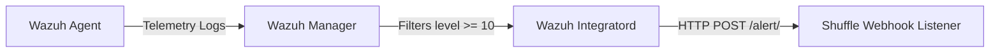

# M2.2 — Wazuh to Shuffle Webhook Integration

This guide describes how to configure the Wazuh Manager to automatically forward security alerts of level 10 or above to the Shuffle webhook endpoint, establishing the communication link between real-time detection and automated orchestration.

---

## 1. Integration Flow Architecture

Wazuh provides a native `<integration>` block to POST alerts to external APIs without requiring customized scripts. Whenever an alert is fired matching the level filter, the manager pushes the full alert JSON payload to Shuffle.



---

## 2. Wazuh Manager Configuration (`ossec.conf`)

Add the following `<integration>` block to `/var/ossec/etc/ossec.conf` on your Wazuh Manager:

```xml
<ossec_config>
  <integration>
    <name>custom-webhook</name>
    <hook_url>https://shuffle.aml-lab.infosecfoster.com/api/v1/hooks/webhook_endpoint_id</hook_url>
    <level>10</level>
    <alert_format>json</alert_format>
  </integration>
</ossec_config>
```

> [!NOTE]
> - Replace `webhook_endpoint_id` with the actual webhook ID generated in your Shuffle workflow trigger block.
> - The `<name>` tag MUST be set to `custom-webhook` (or similar valid custom integration handler names) to leverage Wazuh's default integration daemon (`wazuh-integratord`).

---

## 3. Deployment and Activation

1. Apply the configuration update to your manager's ConfigMap:
```bash
KUBECONFIG=~/.kube/config kubectl apply -f /opt/aml-siem/k8s/base/wazuh-manager/
```
2. Restart the Wazuh manager pods:
```bash
KUBECONFIG=~/.kube/config kubectl rollout restart statefulset wazuh-master -n aml-lab
KUBECONFIG=~/.kube/config kubectl rollout restart statefulset wazuh-worker -n aml-lab
```

---

## 4. Verification Gate

### 4.1 Triggering a Level 10 Alert
Generate a SSH brute-force event by attempting 5 failed logins on a test agent (which triggers Wazuh rule `5712` or `5720` at level 10+):
```bash
for i in {1..5}; do
  ssh -o ConnectTimeout=2 -o StrictHostKeyChecking=no invalid_user@34.18.214.72 2>/dev/null
done
```

### 4.2 Verifying Ingestion inside Shuffle
Verify that within 10 seconds:
1. The Shuffle execution log registers a new workflow run.
2. The incoming webhook parameters parse the full alert schema.
3. Confirm that the following fields are present and correctly populated:
   - `agent.name`: Name of the compromised system/agent.
   - `rule.id`: The specific signature ID (e.g. `5712`).
   - `rule.description`: Description of the alert event.
   - `rule.level`: Level integer (should be 10 or greater).
   - `rule.mitre.technique`: MITRE mapping details if available.
