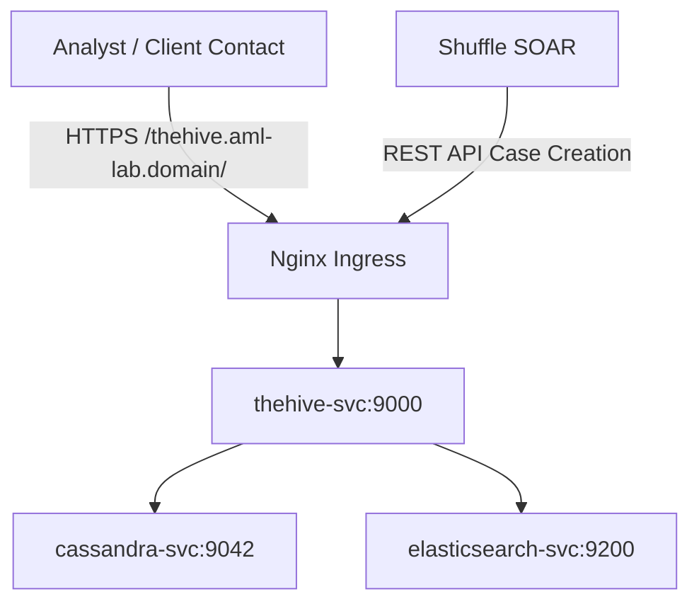

# M2.3 — TheHive 5.2 — Deployment

This guide describes how to deploy TheHive 5.2 Incident Management platform as a Kubernetes StatefulSet along with Cassandra 4.0 (metadata store) and Elasticsearch 7.17.9 (search indexing) inside the `aml-lab` namespace, configure TLS ingress, and generate the API keys required for SOAR execution.

---

## 1. Architectural Topology

TheHive utilizes Cassandra as its primary graph database and Elasticsearch for advanced indexing. Storage resources are backed by persistent volume claims to ensure state durability.



---

## 2. Kubernetes Resource Manifests

### 2.1 Elasticsearch Deployment (Search Indexing)
```yaml
apiVersion: apps/v1
kind: Deployment
metadata:
  name: elasticsearch-thehive
  namespace: aml-lab
spec:
  replicas: 1
  selector:
    matchLabels:
      app: elasticsearch-thehive
  template:
    metadata:
      labels:
        app: elasticsearch-thehive
    spec:
      containers:
      - name: elasticsearch
        image: elasticsearch:7.17.9
        ports:
        - containerPort: 9200
        env:
        - name: discovery.type
          value: "single-node"
        - name: ES_JAVA_OPTS
          value: "-Xms512m -Xmx512m"
---
apiVersion: v1
kind: Service
metadata:
  name: elasticsearch-thehive
  namespace: aml-lab
spec:
  selector:
    app: elasticsearch-thehive
  ports:
  - port: 9200
    targetPort: 9200
```

### 2.2 Cassandra StatefulSet (Metadata Database)
```yaml
apiVersion: apps/v1
kind: StatefulSet
metadata:
  name: cassandra
  namespace: aml-lab
spec:
  serviceName: cassandra
  replicas: 1
  selector:
    matchLabels:
      app: cassandra
  template:
    metadata:
      labels:
        app: cassandra
    spec:
      containers:
      - name: cassandra
        image: cassandra:4.0
        ports:
        - containerPort: 9042
          name: cql
        env:
        - name: CASSANDRA_CLUSTER_NAME
          value: "th_cluster"
  volumeClaimTemplates:
  - metadata:
      name: cassandra-data
    spec:
      accessModes: [ "ReadWriteOnce" ]
      resources:
        requests:
          storage: 10Gi
---
apiVersion: v1
kind: Service
metadata:
  name: cassandra
  namespace: aml-lab
spec:
  selector:
    app: cassandra
  ports:
  - port: 9042
    targetPort: 9042
```

### 2.3 TheHive StatefulSet & Ingress
```yaml
apiVersion: apps/v1
kind: StatefulSet
metadata:
  name: thehive
  namespace: aml-lab
spec:
  serviceName: thehive
  replicas: 1
  selector:
    matchLabels:
      app: thehive
  template:
    metadata:
      labels:
        app: thehive
    spec:
      securityContext:
        fsGroup: 999
      containers:
      - name: thehive
        image: strangebee/thehive:5.2
        ports:
        - containerPort: 9000
        command:
        - "/opt/thehive/bin/thehive"
        - "--secret"
        - "aml-siem-very-long-secret-key-32-chars-minimum"
        - "--cql-hostnames"
        - "cassandra"
        - "--index-backend"
        - "elasticsearch"
        - "--es-hostnames"
        - "elasticsearch-thehive"
        volumeMounts:
        - name: thehive-storage
          mountPath: /opt/thp/thehive/files
  volumeClaimTemplates:
  - metadata:
      name: thehive-storage
    spec:
      accessModes: [ "ReadWriteOnce" ]
      resources:
        requests:
          storage: 10Gi
---
apiVersion: v1
kind: Service
metadata:
  name: thehive
  namespace: aml-lab
spec:
  selector:
    app: thehive
  ports:
  - port: 9000
    targetPort: 9000
---
apiVersion: networking.k8s.io/v1
kind: Ingress
metadata:
  name: thehive-ingress
  namespace: aml-lab
  annotations:
    kubernetes.io/ingress.class: nginx
    cert-manager.io/cluster-issuer: letsencrypt-prod
    nginx.ingress.kubernetes.io/ssl-redirect: "true"
    nginx.ingress.kubernetes.io/force-ssl-redirect: "true"
spec:
  tls:
  - hosts:
    - thehive.aml-lab.infosecfoster.com
    secretName: thehive-tls
  rules:
  - host: thehive.aml-lab.infosecfoster.com
    http:
      paths:
      - path: /
        pathType: Prefix
        backend:
          service:
            name: thehive
            port:
              number: 9000
```

---

## 3. Initial Configuration & Organization Setup

1. **Initial Login:** Access the UI at `https://thehive.aml-lab.infosecfoster.com`. The default administrator credentials are:
   - Username: `admin@thehive.local`
   - Password: `secretpassword`
2. **Create Organization:** Navigate to **Organizations** and click **Add Organization**. Name it `AML-LAB`.
3. **Add Analyst Account:** Inside the `AML-LAB` organization:
   - Click **Users** -> **Create User**.
   - Profile: `Analyst`
   - Username: `analyst@amlakalarabia.com`
4. **Generate API Key:** Log in as the analyst user, navigate to the user profile, and click **API Keys** -> **Create API Key**. Copy this key.
5. **Save to Kubernetes Secret:** Save the key in the namespace to allow Shuffle to fetch it:
```bash
kubectl create secret generic thehive-api-key \
  --from-literal=api-key='YOUR_COPIED_API_KEY' \
  -n aml-lab
```

---

## 4. Verification Gate

```bash
# 1. Verify ingress responds with TLS
curl -k -I https://thehive.aml-lab.infosecfoster.com

# 2. Test Case Creation via Curl using API key:
curl -X POST https://thehive.aml-lab.infosecfoster.com/api/v1/case \
  -H "Authorization: Bearer YOUR_COPIED_API_KEY" \
  -H "Content-Type: application/json" \
  -d '{"title": "M2.3 Ingestion Validation Case", "description": "Verification case injected via REST API", "severity": 2}'
```
Check that the case appears in TheHive UI dashboard within 30 seconds.
