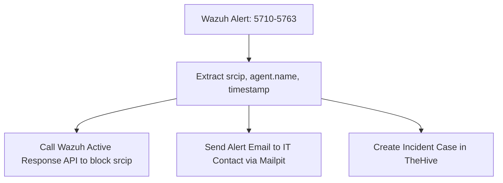

# M2.4 — Playbook 1 — Brute Force Detection and Block

This guide details the implementation of Playbook 1 (SSH Brute Force Remediation). When multiple authentication failures (Wazuh rules `5710` to `5763`) occur, Shuffle extracts the attacker's source IP, blocks the IP at the host firewall using Wazuh Active Response, notifies the security team via email, and logs incident evidence inside TheHive.

---

## 1. Automation Flowchart



---

## 2. Playbook Logic Design

### 2.1 Trigger Conditions
The playbook triggers on any incoming Wazuh manager integration webhook where the alert meets the following rules:
- `rule.id` matches regex: `^(5710|5711|5712|5715|5716|5720|5758|5760|5763)$` (SSHD authentication failures)
- `rule.level` is 10 or greater.

### 2.2 Active Response Execution
Shuffle invokes the Wazuh manager API Active Response endpoint (`PUT /active-response/{agent_id}` or via `wazuh-control` action trigger) passing:
- `command`: `firewall-drop` (the active response script configured on the agent/host)
- `alert`: Pass the full alert structure containing `srcip` in the parameters.
This drops traffic from the attacking IP using `iptables` or local host security firewalls.

### 2.3 Local Mock SMTP Relay (Mailpit)
To capture and inspect automated emails within the lab environment, we deploy a local Mock SMTP service **Mailpit** inside the `aml-lab` namespace.

#### Mailpit Kubernetes Manifest:
```yaml
apiVersion: apps/v1
kind: Deployment
metadata:
  name: mailpit
  namespace: aml-lab
spec:
  replicas: 1
  selector:
    matchLabels:
      app: mailpit
  template:
    metadata:
      labels:
        app: mailpit
    spec:
      containers:
      - name: mailpit
        image: axllent/mailpit:latest
        ports:
        - containerPort: 1025  # SMTP Port
          name: smtp
        - containerPort: 8025  # Web UI Port
          name: http
---
apiVersion: v1
kind: Service
metadata:
  name: mailpit
  namespace: aml-lab
spec:
  selector:
    app: mailpit
  ports:
  - port: 1025
    targetPort: 1025
    name: smtp
  - port: 8025
    targetPort: 8025
    name: http
```
Shuffle SMTP connector is configured to use:
- Host: `mailpit.aml-lab.svc.cluster.local`
- Port: `1025`
- Security: None (plain TCP)

### 2.4 TheHive Case Generation
Shuffle calls TheHive REST API (`POST /api/v1/case`) with the following payload structure:
```json
{
  "title": "Brute Force Attack Detected: Blocked Source IP",
  "description": "System telemetry registered SSH brute force. Source IP has been blocked at the agent firewall.\n\n- Attacker IP: ${alert.data.srcip}\n- Agent Host: ${alert.agent.name}\n- Rule ID: ${alert.rule.id}\n- Timestamp: ${alert.timestamp}",
  "severity": 3,
  "tags": ["brute-force", "active-response", "sshd"]
}
```

---

## 3. End-to-End Verification Gate

1. **Trigger Attack:** Run a brute-force script (e.g. 5 failed logins) targeting the test agent:
```bash
for i in {1..5}; do
  ssh -o ConnectTimeout=2 -o StrictHostKeyChecking=no invalid_user@34.18.214.72 2>/dev/null
done
```
2. **Verify Remediation (within 90 seconds):**
   - **Firewall Block:** Check the active iptables rules on the agent VM. The attacking IP must appear in the drop lists:
     `sudo iptables -L -n | grep DROP`
   - **Email Ingestion:** Access the Mailpit web console (forward port `8025` or check service) and confirm that the warning notification exists.
   - **TheHive Case:** Verify that a new case has been logged inside TheHive dashboard with matching attacker details.
