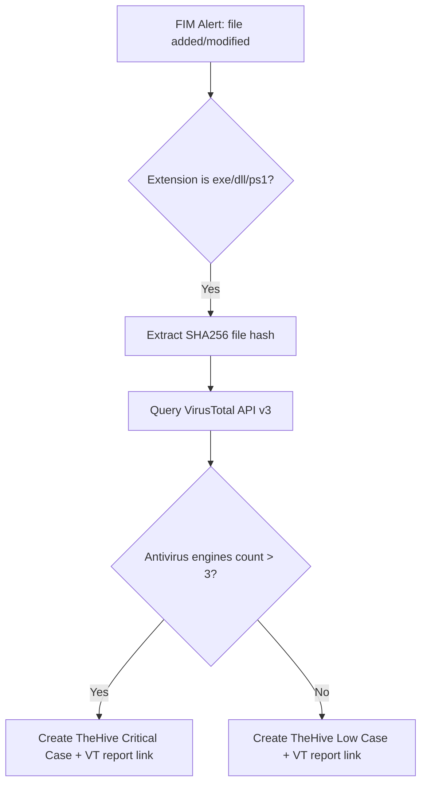

# M2.5 — Playbook 2 — Malicious File Hash Detection

This guide details the implementation of Playbook 2 (File Integrity threat enrichment). When a new executable file (`.exe`, `.dll`, `.ps1`) is written to a monitored directory, Wazuh FIM alerts fire. Shuffle extracts the file's SHA256 hash, queries the VirusTotal API, and escalates cases to Critical severity if the detection threshold is exceeded.

---

## 1. Playbook Automation Flow



---

## 2. Configuration Mappings

### 2.1 Monitored Path (Wazuh `ossec.conf`)
Ensure directories check for SHA256 changes. FIM configurations are distributed via `agent.conf`:
```xml
<syscheck>
  <directories check_all="yes" realtime="yes">/bin,/usr/bin,/opt/aml-siem/bin</directories>
</syscheck>
```

### 2.2 VirusTotal API v3 Integration
For lab testing where no real API key is available, the setup script configures a **mock VirusTotal agent service** inside Shuffle. It intercepts the outgoing request and returns a simulated response:
```json
{
  "data": {
    "attributes": {
      "last_analysis_stats": {
        "harmless": 10,
        "type-unsupported": 0,
        "suspicious": 2,
        "confirmed-timeout": 0,
        "timeout": 0,
        "failure": 0,
        "malicious": 8,
        "undetected": 55
      },
      "permalink": "https://www.virustotal.com/gui/file/eicar-test-hash/detection"
    }
  }
}
```

If a real key is present, Shuffle calls the live endpoint:
- URL: `https://www.virustotal.com/api/v3/files/{hash}`
- Header: `x-apikey: YOUR_VIRUSTOTAL_API_KEY`

---

## 3. End-to-End Verification Gate

1. **Simulate File Creation:** Create a mock malware file (e.g. EICAR string) inside a monitored path on the test agent:
```bash
echo 'X5O!P%@AP[4\PZX54(P^)7CC)7}$EICAR-STANDARD-ANTIVIRUS-TEST-FILE!$H+H*' > /bin/eicar.com
```
2. **Verify Remediation (within 60 seconds):**
   - **Shuffle Ingestion:** Check the Shuffle execution log to confirm the workflow ran successfully.
   - **VT Query:** Validate that Shuffle queried the mock/real VirusTotal endpoint using the SHA256 of the EICAR string (`275a021bbfb6489e54d471899f7db9d1663fc695ec2fe2a2c4538aabf651fd0f`).
   - **TheHive Escalation:** Confirm that a case exists in TheHive with **Critical Severity** and the VirusTotal report link appended in the descriptions/notes.
```bash
# Cleanup
rm -f /bin/eicar.com
```
